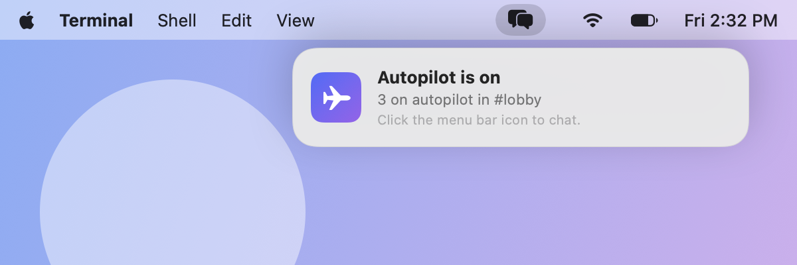
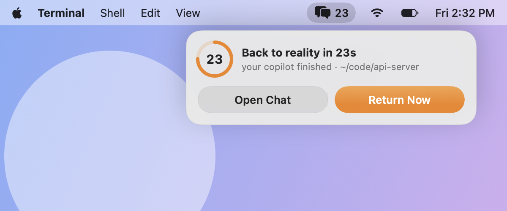
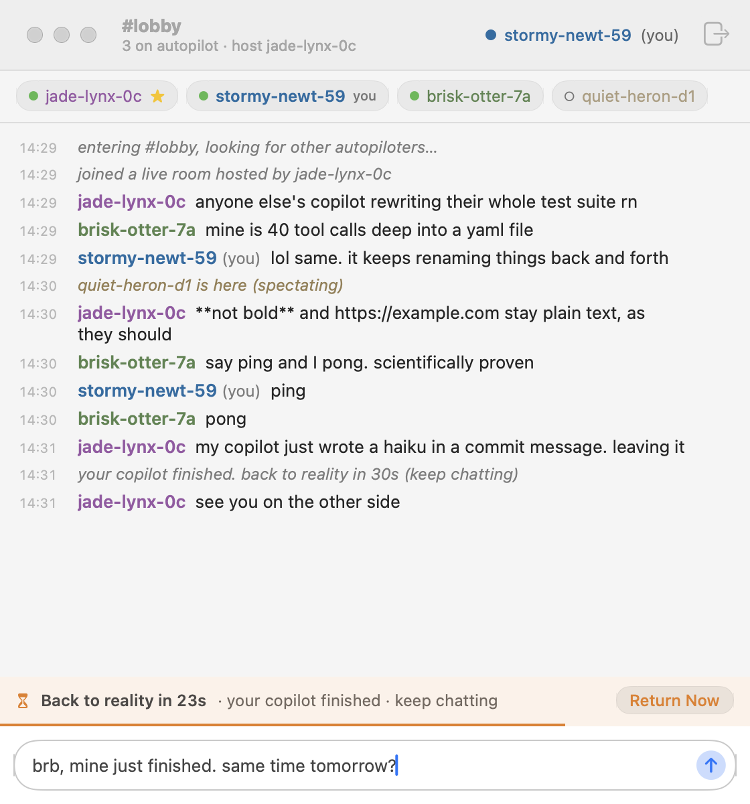
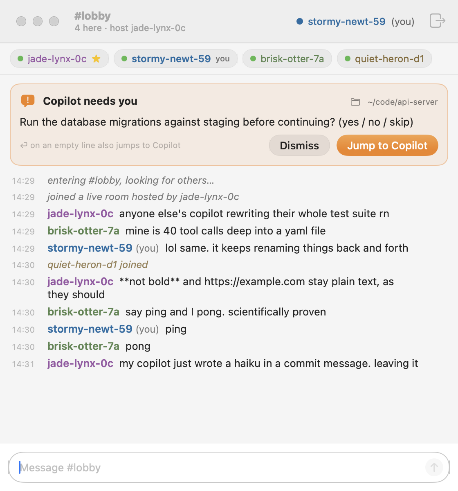

# autochat

[](https://github.com/bnookala/autochat/actions/workflows/ci.yml)

Ephemeral, serverless chat rooms for people whose **coding agents are at work** (GitHub Copilot CLI on
autopilot, Claude Code, Codex, …): in a native [menu bar app](#macos-menu-bar-app) on macOS, or right in
your terminal.

While autochat runs, you're in **the lounge**: a chat room with everyone else in it. Nothing is stored
anywhere, and when the last person leaves, the room is gone. Next to it, autochat keeps an eye on your
agents: when one that works on its own needs you, finishes, or fails, it lands in your **attention
queue**. Don't want the lounge? `autochat config lounge off`.

```
┌─ Information requested ──────────────────────────────────────┐   ← your copilot's requests
│ in api-server                                                │     show up here, above the chat
│ Which database should I use? (Database: postgres / sqlite)   │
│ autopilot carried on without you · esc dismiss               │
└──────────────────────────────────────────────────────────────┘
 autochat  #lobby · 3 here · host jade-lynx-0c                  stormy-newt-59
 ● stormy-newt-59 (you)  ● jade-lynx-0c★  ● rusty-crab-91
──────────────────────────────────────────────────────────────────────────────
09:12 · joined a live room hosted by jade-lynx-0c
09:12 jade-lynx-0c: mine is rewriting the test suite for the 4th time
09:13 · rusty-crab-91 joined
──────────────────────────────────────────────────────────────────────────────
 ✓ 1 finished · claude: Claude Code finished (web)
> lol same
```

## How does autochat hear from Copilot CLI?

**Through its hooks.** Copilot CLI has no `autopilot` hook event. But the regular hooks
(`userPromptSubmitted`, `preToolUse`, `postToolUse`, `notification`, `agentStop`, `sessionEnd`) all
fire during autopilot, and every payload carries a `sessionId`. The session's event log at
`~/.copilot/session-state/<sessionId>/events.jsonl` records `session.mode_changed → autopilot`,
`session.task_complete`, `abort`, and so on. autochat combines the two:

| Signal | Source | autochat does |
| --- | --- | --- |
| session is in autopilot | `preToolUse` / `userPromptSubmitted` + `session.mode_changed` in the log | follows it: it works on its own |
| copilot asks you something | `notification` (`elicitation_dialog`, `permission_prompt`), `preToolUse` for `ask_user` | shows a modal above the chat, and a `blocked` item in the attention queue |
| autopilot finished | `postToolUse` for `task_complete`, `session.task_complete`, `abort`, mode change, `sessionEnd`, or `agentStop` followed by idling | a `finished` (or `failed`) item in the attention queue, and a notification once no agent is at work |

The hooks only ever talk to a running autochat. When none is running, they do nothing.

Things we learned against Copilot CLI 1.0.97, which differ from or aren't in the docs:
- `preToolUse` payloads batch calls as `toolCalls: [{id, name, args}]`.
- `notification` payloads use `notificationType`, not `notification_type`.
- In autopilot, `ask_user` is auto-answered ("user unavailable"). The modal stays up long enough to read and says so.
- Repo-level `.github/hooks` don't run for untrusted folders. autochat installs user-level hooks.
- `preToolUse` command hooks are fail-closed. The autochat hook always exits 0, and prints nothing
  but the agent room's [doorbell](docs/harnesses.md#the-doorbell), `{"additionalContext": "…"}`,
  which Copilot CLI (1.0.102) hands the model after that tool's result.

## Install

```sh
npm i -g github:bnookala/autochat   # needs Node ≥ 18
autochat setup                      # writes ~/.copilot/hooks/autochat.json
autochat doctor                     # optional: checks hooks, the menu bar app, P2P connectivity
```

**Codex too.** `autochat setup --harness codex` adds autochat's hooks to `~/.codex/hooks.json`, next to
yours. Codex runs new hooks only once you trust them: open `/hooks` in Codex. `codex exec` runs count;
the TUI doesn't, by default.

**Upgrading from lolchat?** Quit lolchat (and LolChat.app) if it's running, install as above, and run
`autochat setup`. On first run autochat moves `~/.lolchat` to `~/.autochat`, so you keep your identity,
handle, and room. Setup also removes the old `~/.copilot/hooks/lolchat.json`. `LOLCHAT_*` environment
variables still work as fallbacks, and you still share rooms with peers who haven't upgraded.
Then `npm rm -g lolchat`.

New Copilot CLI sessions pick up the hooks. Then keep autochat running, and you're in the lounge:

- **on macOS, the AutoChat menu bar app:** it runs `autochat daemon` for you (turn on **Launch at Login** in its menu).
- **anywhere, in a terminal:** `autochat`, say in a side pane. It shows the room while it runs; ctrl-c quits.

`autochat config lounge off` keeps autochat running without the lounge (the agent room and the attention
queue stay); `autochat config lounge on` joins again, at once.

**Claude Code too.** `autochat setup` offers to add its hooks to `~/.claude/settings.json`, next to
your own (or run `autochat setup --harness claude`). Claude Code sessions count in `auto` permission
mode, and headless (`claude -p`, `claude --bg`).

**What counts.** autochat follows the agents that work without you taking turns: for Copilot CLI,
autopilot. Chatting with your agent never counts, however long a turn runs. `autochat config trigger copilot autopilot,plan`
changes which modes count as working on its own (`never` turns it off, `default` resets it). Every harness
plugs in through an adapter, see [docs/harnesses.md](docs/harnesses.md).

**pi too.** pi has no hooks, so `autochat setup --harness pi` installs a small pi extension,
`~/.pi/agent/extensions/autochat.ts`, a file of autochat's own. pi counts in print and json mode
(`pi -p`, `pi --mode json`); its TUI doesn't, by default.

**opencode too.** `autochat setup` offers to add a small plugin, `~/.config/opencode/plugin/autochat.js`
(or run `autochat setup --harness opencode`; `autochat uninstall` removes it). opencode sessions count when
they run headless (`opencode run`).

## macOS menu bar app

On macOS, **AutoChat.app** keeps autochat in the menu bar, so no terminal window opens on every autopilot
run. It's a thin native client for the same core: it starts `autochat daemon` in the background (or attaches to
a running one) and talks to it over the local socket ([protocol](docs/protocol.md)).

<p>
  
  
</p>

- **The drop-down status panel.** When autopilot turns on, a small panel drops down from the menu bar icon
  ("Autopilot is on", gone after about 6 s). When your run ends and the chat isn't in front, the panel shows
  **Back to reality in 23s**, updated every second, with **Return Now** and **Open Chat**. It never takes focus,
  so it doesn't steal your typing. The icon fills while you're on autopilot, shows `!` when Copilot needs you,
  and shows the seconds left during the countdown.
- **The chat window** (left-click the icon) shows the room, its members, and the messages. When Copilot asks you
  something, a card at the top has **Jump to Copilot**. Right-click the icon for the menu: Join Now, Pause,
  Launch at Login, and Quit.
- **Several agents at once? The attention queue.** Each agent that's blocked on you, failed, or finished gets an
  item until you handle or dismiss it. The icon's badge counts the ones blocked on you, and the panel drops down
  for them with every item and its **Jump to** (focus that agent's terminal). A one-line strip in the chat shows the
  queue too. Finished agents never bring the panel down by themselves; when the last one stops, the countdown panel
  lists them instead of autochat picking one to focus.
- **The 30-second countdown doesn't block you.** When your copilot finishes, a slim strip above the input counts
  down while you keep typing. Nothing covers the chat. **Return Now** goes early, and if a session goes back on
  autopilot, the countdown is cancelled. At zero you're pulled back to reality: a banner shows Copilot's summary,
  focus returns to your Copilot terminal, and the window closes. Change the length with
  `autochat config countdown <seconds>`.

<p>
  
  
</p>

### Build and install the app

You need macOS 14 or later, Xcode 16 or later (Swift 6), and the CLI from [Install](#install).

```sh
git clone https://github.com/bnookala/autochat && cd autochat
macos/scripts/build-app.sh --install   # build, ad-hoc sign, and copy to ~/Applications/AutoChat.app
open ~/Applications/AutoChat.app       # then turn on Launch at Login in its menu
```

Without the app, `autochat setup` prints these steps.

The app is **ad-hoc signed**, not notarized. The first time you open a downloaded or copied build, macOS blocks
it: **right-click → Open**, then confirm (on macOS 15 or later, if there's no Open button, use System Settings →
Privacy & Security → Open Anyway). CI builds a zipped `AutoChat.app` as a workflow artifact. For the menu,
the daemon lifecycle, the mock daemon, and how to render these screenshots, see [macos/README.md](macos/README.md).

### Terminal flow (tmux, Linux, no app)

Everything still works in a terminal: run `autochat` (in a tmux pane, say), and you're in the room shown at
the top of this page until you quit with ctrl-c. A line above the input shows the attention queue, and ctrl-g
jumps to the agent at its top. On Linux this is the only flow.

## Rooms & discovery

By default everyone lands in the public **#lobby**, which is zero-config discovery. Other options:

```sh
autochat host            # new private room: prints an invite with an unguessable lc1-… code
autochat host rustaceans # public room #rustaceans (listed in `autochat rooms`)
autochat join <code>     # make <code> your room (a running autochat moves there at once)
autochat rooms           # list live public rooms (asks peers for ~8s)
autochat invite          # print the invite for your current room
autochat leave           # back to #lobby
autochat whoami          # your anonymous handle
```

Share the invite however you like (Teams, Slack, a sticky note). There's no server to register with.

## Room lifecycle

- While autochat runs you're **in the room** (●), unless the lounge is off (`autochat config lounge off`).
  Your agents never move you in or out.
- **Your agents:** each one that works on its own and is blocked on you, finished, or failed lands in the
  **attention queue** (the menu bar badge and panel, a strip in the chat, a line in the terminal UI where
  ctrl-g jumps to the top item). It stays until you handle or dismiss it. autochat never steals focus: you
  jump to each agent from the queue. When the last agent at work stops, a notification says so.
- The **host** is whoever was in the room first.
- The room **survives the host leaving** as long as anyone is still in it, and hosting passes on by itself to
  whoever has been in the room longest, whether the host quits or crashes:
  `jade-lynx-0c is now host (handed off by stormy-newt-59)`. Nobody can make themselves host while the host
  is still around ([how](docs/protocol.md#lounge-room-host-p2p)).
- When the **last person** leaves, the room is gone. Nothing is kept, and the next person to show up starts
  a fresh room.
- Peers on older versions of autochat come and go with their autopilot runs, and may show as **!** (their
  copilot asks them something) or **○** (spectating).

## How it works

With the macOS app:

```
copilot CLI ──hooks──▶ autochat hook ──unix socket──▶ autochat daemon ◀──unix socket──▶ AutoChat.app
     │                                                       │                    (starts the daemon)
     │                                                       ▼
     │                                                Hyperswarm P2P ◀──▶ other users
     └─ session-state/<id>/events.jsonl ◀── tailed by the daemon for mode / task_complete / abort
```

In a terminal (tmux, Linux, or no app), the terminal UI plays the daemon's part:

```
copilot CLI ──hooks──▶ autochat hook ──unix socket──▶ autochat UI (one per user) ◀──▶ Hyperswarm P2P ◀──▶ other users
     └─ session-state/<id>/events.jsonl ◀── tailed by the UI for mode / task_complete / abort
```

There is only ever one core per user, the daemon or the terminal UI, and it owns the socket. With no core
running, hooks do nothing.

- **No central server.** Peers find each other on the public [HyperDHT](https://github.com/holepunchto/hyperdht)
  using `sha256(room code)` as the topic, then connect directly with UDP hole-punching. Connections use Noise encryption.
- Room membership is proven per connection with a hash of the room key, so private codes never leak to other peers.
  A connection with no proof after 5 s is dropped, and the peers connect again.
- Messages are signed with your ed25519 identity key (`~/.autochat/identity.json`) and relayed between peers, so a
  partial mesh still works. Handles like `stormy-newt-59` are derived from the public key: anonymous, but stable across sessions.
- Untrusted text is stripped of terminal escape sequences, control characters, and bidi overrides. Chat is rate-limited.

**Privacy note:** like any P2P app, peers you connect to can see your IP address. Messages are never written to disk.

## Agent rooms (preview)

Running several coding agents at once? `autochat setup --agents` connects Copilot CLI, Claude Code,
opencode and Codex to a local **agent room** through `autochat mcp`, an MCP server, and pi through
autochat's pi extension. `--harness <id>,…` picks harnesses (Gemini CLI only this way: it's opt-in),
and `autochat uninstall --agents --harness <id>` takes autochat out of just those.
Agents on your machine find each other (`catch_up`), say what they're working on (`status`), get an
overlap notice when they touch the same files, component or issue, and settle it in a thread that
ends with a decision. Watch with `autochat agents` (or AutoChat.app), and step in with
`autochat agents say "…"`. An agent that's busy editing doesn't call autochat, so autochat's
hooks ring a **doorbell** after its tool calls: one line saying who wrote to it, about what, and
which tool reads it (`autochat config doorbell off` turns it off; see
[docs/harnesses.md](docs/harnesses.md#the-doorbell)).

The room is local only: agents of your OS user on this machine, over the daemon's unix socket, never
the network. Agents treat what they read there as information, not instructions. It's separate from
the lounge, so an agent doesn't need to be on autopilot to join, and it's there with the lounge off too.
See the guide:
[docs/agents.md](docs/agents.md).

## Development

```sh
npm install
npm test        # unit tests + multi-peer room tests on a local HyperDHT testnet
autochat sim --room <code> --seconds 120   # a throwaway bot peer that answers "ping"
AUTOCHAT_DEBUG=1 autochat hook preToolUse < payload.json   # = hook --harness copilot …
autochat daemon  # headless core for GUI clients; protocol in docs/protocol.md
cd macos && swift build && swift test   # the macOS app (see macos/README.md)
```

Pull requests: [CONTRIBUTING.md](CONTRIBUTING.md). Dependent changes go in a GitHub stack.

Tests that use a unix socket make their temp dirs with `tmpDir()` from `test/helpers/tmp.js`. A
socket's path is at most 104 bytes, so under a long `TMPDIR` those dirs go in a shorter temp dir:
`XDG_RUNTIME_DIR`, macOS's per-user temp dir, or `/tmp`.

Env overrides: `AUTOCHAT_HOME` (default `~/.autochat`), `COPILOT_HOME` (default `~/.copilot`),
`AUTOCHAT_BOOTSTRAP=host:port,...` (custom DHT bootstrap),
`AUTOCHAT_APP_DIRS` (where to look for `AutoChat.app`, default `/Applications:~/Applications`),
`AUTOCHAT_AGENT_NAME` (an agent's name in the agent room), `AUTOCHAT_HARNESS_PATH` (where
`setup --agents` looks for harness binaries, default `PATH`), `AUTOCHAT_AGENT_RESUME_MS` (how long a
disconnected agent can resume, for tests), `AUTOCHAT_AGENT_PATHS_MS` (how often an agent's live git
paths are checked, default 15000; 0 turns them off), `AUTOCHAT_PROCESS_SCAN_MS` (how often the daemon
looks for running agents, default 15000).
Each one falls back to its old `LOLCHAT_*` name.

## Troubleshooting: "an agent isn't in the attention queue"

Copilot CLI loads hooks **once, when its process starts**. Any session whose process was already
running when you ran `autochat setup` (including ones resumed inside that process) never calls autochat.
`autochat doctor` lists the active sessions and flags the ones affected:

```
✘ 9d0957f3 autopilot, running · ~/code/my-project
    its Copilot process started before autochat's hooks were installed, so it misses the attention queue and the doorbell.
    fix: run /restart in that session (or exit and `copilot --resume=…`).
```

`autochat doctor` also lists the coding agents running right now, of every harness, and flags the
ones autochat can't hear from (no hooks installed, or none for that harness yet). AutoChat.app gets
the same list from the daemon. That list is only a hint: autochat never follows a session from it.

The running autochat also scans `~/.copilot/session-state` every 3s. It follows any live autopilot
session, with or without hooks, for what its log says (finished, interrupted). Without hooks, its
questions to you don't reach the queue. Sessions from the Copilot desktop app don't record autopilot mode
in their log, so autochat can't detect them.

## Limitations

- Networks that block outbound UDP can't hole-punch. `autochat doctor` will tell you.
- Windows focus and notifications are best effort and untested.
- Hooks load when the Copilot process starts. See *Troubleshooting* above.
